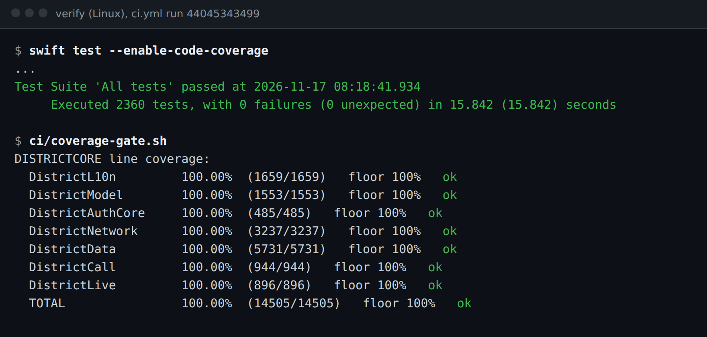

<picture>
  <source media="(prefers-color-scheme: dark)" srcset=".github/assets/distronode-logo-dark.png">
  <source media="(prefers-color-scheme: light)" srcset=".github/assets/distronode-logo-light.png">
  
</picture>

# District Core for Swift

[](https://www.bestpractices.dev/projects/15872)
[](https://scorecard.dev/viewer/?uri=github.com/distronode-corporation/district-core-swift)
[](https://github.com/distronode-corporation/district-core-swift/releases/latest)
[](LICENSE)
[](https://github.com/distronode-corporation/district-core-swift/actions/workflows/ci.yml)

The shared Swift core of the native [District AI](https://www.distronode.com/district-ai) apps
from [Distronode](https://distronode.com): the models, networking, sign-in and call logic the
iPhone, iPad and Mac clients have in common, built and tested on Linux as well as on Apple
platforms.



<sub>An excerpt of the `verify (Linux)` job's log in
[CI run 44045343499](https://github.com/distronode-corporation/district-core-swift/actions/runs/44045343499)
(commit `bf9ddbc`, 2026-11-17), rendered as a terminal. Functions and regions are held at 100% the
same way.</sub>

**Quick start:** add the package and a product to your `Package.swift` (a first call is in
[Quick start](#quick-start) below):

```swift
.package(url: "https://github.com/distronode-corporation/district-core-swift", exact: "9.0.0"),
.product(name: "DistrictL10n", package: "district-core-swift"),
```

**Links:** [Distronode](https://distronode.com) ·
[project page](https://www.distronode.com/open-source/district-core-swift) ·
[Distronode on GitHub](https://github.com/distronode-corporation) ·
[CHANGELOG](CHANGELOG.md) · [ROADMAP](ROADMAP.md) ·
[GitLab mirror](https://gitlab.com/distronode-corporation/district-core-swift) (read only;
issues and pull requests live on GitHub)

## What it is

The models, networking, data repositories, sign-in logic and call state machines that the
District AI apps for iPhone, iPad and Mac have in common. It builds and tests on Linux as well
as on Apple platforms, so almost all of the apps' logic is tested without a simulator, a
network or an account.

Consumers:

- [District AI for iOS](https://github.com/distronode-corporation/district-ios)
  (iPhone and iPad)
- [District AI for Mac](https://github.com/distronode-corporation/district-macos)

This package was extracted from district-ios at `0b2354b`, with its history. The
release badge above names the current release.

The District AI service the package talks to is not open source; signing in needs a
District AI account. Without one you can still build the package and run every test.

**Without an account with us.** Today the District AI apps need a District AI account to
sign in. We want them to work without an account with us too. We have not worked out
what that looks like or whether it can work, and the answer depends on what people would
use them with, so we are asking before we build anything:
[tell us what you would connect them to](https://github.com/distronode-corporation/.github/discussions/1).

## Using it

Swift 6.2 or later, Swift 6 language mode. Platforms: **iOS 17** and **macOS 14** (the
deployment targets in `Package.swift`), plus Linux for building and testing.

```swift
dependencies: [
    .package(url: "https://github.com/distronode-corporation/district-core-swift", exact: "9.0.0"),
],
```

Pin an exact version. The apps do, so that a core change reaches a store build only
through a reviewed version bump.

In an XcodeGen `project.yml`:

```yaml
packages:
  DistrictCore:
    url: https://github.com/distronode-corporation/district-core-swift
    exactVersion: 9.0.0
```

## Quick start

With Swift 6.2 or later, the smallest use of the core is the formats every District AI app
shows, which need no account and no network. In a package that depends on this one (see
Using it, above), with `DistrictL10n` in the target's dependencies:

```swift
import DistrictL10n

let locale = DistrictL10n.locale(fromPreferred: ["fr-CA", "en-US"])
print(locale)                                                       // frCA
print(L10nFormat.minutesSeconds(125, locale: .en))                  // 2m 5s
print(L10nFormat.list(["Inbox", "Calls", "Contacts"], locale: .en))  // Inbox, Calls and Contacts
```

To build the package itself and run every test, see Build and test below.

## Uninstall

Nothing here installs anything on the machine: the modules are compiled into the app that
uses them. To stop using them, remove the `.package(...)` line and the products from your
`Package.swift`, or in Xcode select the package under Package Dependencies in the project
settings and remove it. SwiftPM keeps a cached copy of each remote package it has fetched:
`swift package purge-cache` removes it, and Xcode's `DerivedData` folder holds its build
products. For a clone, delete the directory. What an app built on the package keeps on the
device (its Keychain items, its settings) is that app's to remove; its README says how.

## Modules

Each module is a library product. All of them import only Foundation (and
FoundationNetworking on Linux).

| Module | What it holds |
| --- | --- |
| `DistrictL10n` | Every piece of display text the core produces, in English or Canadian French, generated from the catalogs in `l10n/`; the language switch (`L10nRuntime`); and the formats for money, dates, times, durations, numbers, percentages and lists (`L10nFormat`), held byte for byte to the website's. Also the API error code sentences (`ApiErrorText`) and the wire value labels (`WireLabel`). Depends on nothing. |
| `DistrictModel` | Codable DTOs for every response the apps decode, and the single normalised error type, `ApiError`. Depends only on `DistrictL10n`. |
| `DistrictAuthCore` | PKCE (S256), the Sign in with Apple nonce, token refresh coordination, revocation and sign-out. Token storage is the `TokenStore` protocol; each app implements it with the Keychain. |
| `DistrictNetwork` | Every endpoint and path, the API client, error-envelope normalisation and the native sign-in exchanges. The HTTP transport is the `HTTPTransport` protocol, so libcurl and Darwin `URLSession` differences never reach feature code. |
| `DistrictData` | Repositories and paging over `DistrictNetwork`. |
| `DistrictCall` | Everything about a call that is not the media SDK or the OS call registry: the `CallEngine` seam, the outbound and inbound state machines and the commands they emit. |
| `DistrictLive` | Live updates: the telemetry socket's state machine (`TelemetryConnection`) and the actor that runs it, with the live transcript's ops; a call's live transcript (`TranscriptReducer`); the Mac's presence (`PresenceController`) and the ring gate (`DesktopRingGate`). The socket is the `TelemetrySocketTransport` protocol and time is the `LiveClock` protocol, so every rule is tested on Linux without a server or a wait; the `URLSessionWebSocketTask` adapter lives in the macOS app. |

The one external dependency is [apple/swift-crypto](https://github.com/apple/swift-crypto),
pinned `exact:`, for SHA-256 on Linux (and swift-asn1 through it). `Package.resolved` is
committed.

## Verify a release

From the next release on, every release tag is an annotated tag signed with
[gitsign](https://github.com/sigstore/gitsign): keyless Sigstore signing by the
repository's Release workflow, under its GitHub OIDC identity, with the signature
recorded in Sigstore's public transparency log. There is no long-lived signing key to
publish or to lose. Tags up to and including 8.6.0 were made before this and are not
signed.

With gitsign installed (`brew install gitsign`, `go install github.com/sigstore/gitsign@latest`,
or a binary from its releases page), in a clone with the tags fetched:

```sh
gitsign verify-tag X.Y.Z \
  --certificate-identity https://github.com/distronode-corporation/district-core-swift/.github/workflows/release.yml@refs/heads/main \
  --certificate-oidc-issuer https://token.actions.githubusercontent.com
```

It succeeds only when the tag's signature is valid, is in the transparency log, and was
made by that workflow file running on main of this repository. `git verify-tag` works
too, with gitsign as git's signing program
(`git -c gpg.format=x509 -c gpg.x509.program=gitsign verify-tag X.Y.Z`), but it checks
the signature without checking whose it is; use `gitsign verify-tag` for that.

An app's `Package.resolved` records the commit the tag named, and the tags are protected
against moves and deletion, so a verified tag is also what the app resolves.

## Build and test

```sh
swift build
swift test --enable-code-coverage
ci/coverage-gate.sh        # per-module line-coverage floors, all at 100%
```

`ci/Dockerfile` defines the Linux toolchain CI uses (`swift:6.2.4`, SwiftLint, SwiftFormat).

Lint, from the repository root:

```sh
swiftformat --lint .       # SwiftFormat 0.63.0
swiftlint --strict         # SwiftLint 0.65.1
```

## Languages

The core writes English, and Canadian French once an app turns it on by setting
`L10nRuntime.locale` (to `DistrictL10n.locale(fromPreferred:)` of the device's preferred
languages). Until an app sets it, everything is English.

- The text is in four TOML catalogs under `l10n/`, in the format
  [`tools/l10n/`](tools/l10n) reads: `core.toml` and `countries.toml` are written by
  hand; `api_errors.toml` and `wire.toml` are generated from `contracts/i18n/`.
- `python3 scripts/gen-l10n.py` writes those two catalogs, the Swift in
  `Sources/DistrictL10n/Generated/` and the test that calls every accessor in both
  languages. Never edit a generated file; change a catalog and run the script.
  `python3 scripts/gen-l10n.py --check` is what CI runs.
- `tools/l10n/` is a vendored copy (`SOURCE.toml` names the commit;
  `python3 tools/l10n/l10n.py vendor --check --dest tools/l10n` verifies it).
- Formats are not CLDR: `L10nFormat` is a set of tables tested against
  `contracts/i18n/format-vectors.json`, so a customer reads the same bytes on every OS
  version and on the website.

## The contract gate

`contracts/` holds recorded responses from the District AI service, generated by the
service's own test suite and copied here unchanged (see [contracts/README.md](contracts/README.md)).
`contracts/mobile/` is the set the iOS and Android apps decode; `contracts/desktop/` is the
desktop clients' additions.

`ContractFixtureTests` runs every mobile fixture that has a Swift model through a strict
gate: no `null` outside a reviewed allow-list, decode, re-encode, and the re-encoded keys
must equal the fixture's at every level. It asserts the exact number of fixtures (245)
and an explicit list of fixtures that have no model yet, so a missing directory or a
newly added fixture is a failure rather than a silent pass. Set `DISTRICT_CONTRACTS_DIR`
to read the fixtures from somewhere else.

`DesktopContractFixtureTests` does the same for `contracts/desktop/`: an exact count (14)
and one verifier per file, thirteen through the strict gate and the scheduling hand-off
through the client's own hand-written decoder. Set `DISTRICT_DESKTOP_CONTRACTS_DIR` to
read them from somewhere else.

The strictness is in the tests only. The decoders ignore unknown fields, so an installed
app keeps working when the service adds one.

## Continuous integration

[`.github/workflows/ci.yml`](.github/workflows/ci.yml) runs on every push to `main` and
every pull request, and uses no secrets:

- **verify** (Linux, `swift:6.2.4`): SwiftFormat, SwiftLint, the Foundation-only import
  rule, the `Package.resolved` guard, `swift test`, a floor on the number of tests run,
  and the coverage floors.
- **hygiene** (Linux): no em or en dashes, internal host names or GitLab URLs other than
  this repository's own mirror
  ([`scripts/check-public-hygiene.py`](scripts/check-public-hygiene.py)), the licence
  files present, the vendored catalog tools unmodified, every generated string file
  current, and the French rules (`frcheck`).
- **gitleaks** (Linux): the full git history, with [`.gitleaks.toml`](.gitleaks.toml).
- **zizmor** (Linux): static analysis of the workflows.
- **darwin** (macOS): `swift test`, then `xcodebuild` for generic iOS and generic macOS.
- **dependency graph** (Linux): submits the `Package.resolved` pins to GitHub's dependency graph,
  which cannot see them on its own; on pushes to `main` and pull requests from this
  repository.
- **dependency-review** (Linux, pull requests): fails a pull request that adds a
  dependency with a known moderate-or-worse vulnerability or a licence this package cannot
  ship, compared after the snapshot above has landed.

[`codeql.yml`](.github/workflows/codeql.yml) (the workflows, on every pull request),
[`codeql-swift.yml`](.github/workflows/codeql-swift.yml) (the library targets, on pushes to
`main` that change them, weekly and on demand) and
[`scorecard.yml`](.github/workflows/scorecard.yml) add CodeQL and the OpenSSF Scorecard.

## Changing the core

Changes land here first, in a pull request with its tests. A release is a version tag;
each app then bumps its exact pin in a pull request of its own. See
[CONTRIBUTING.md](CONTRIBUTING.md).

## Contributing, security and conduct

- [CONTRIBUTING.md](CONTRIBUTING.md): the local gate and the rules CI enforces.
- [ARCHITECTURE.md](ARCHITECTURE.md): the modules, the seams the apps implement, a
  request end to end, and where state lives.
- [SECURITY.md](SECURITY.md): report vulnerabilities privately, not in an issue.
- [SECURITY-MODEL.md](SECURITY-MODEL.md): the threat model, trust boundaries, design
  principles and the weaknesses the code counters.
- [GOVERNANCE.md](https://github.com/distronode-corporation/.github/blob/main/GOVERNANCE.md):
  who maintains the project, how a change is accepted, and how a vulnerability is handled.
- [CODE_OF_CONDUCT.md](CODE_OF_CONDUCT.md).
- [SUPPORT](.github/SUPPORT.md): where questions, bugs and account problems go.
- [CHANGELOG.md](CHANGELOG.md).

Questions about a District AI account, number or bill go to
[District AI support](https://www.distronode.com/support).

## License and trademarks

Apache License 2.0. See [LICENSE](LICENSE) and [NOTICE](NOTICE).

District AI, Distronode and the District AI and Distronode logos and app icons are
trademarks of Distronode Corporation. They are not licensed under the Apache License 2.0:
an app you distribute that uses this package must use its own name, icon and bundle
identifier.
